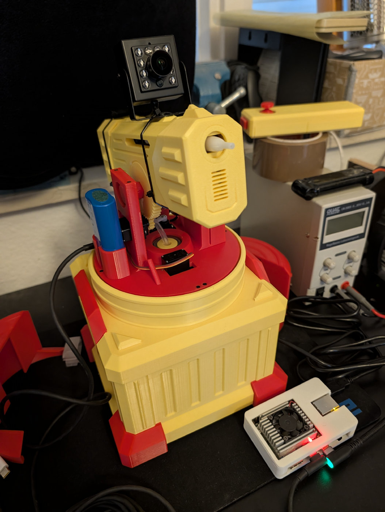
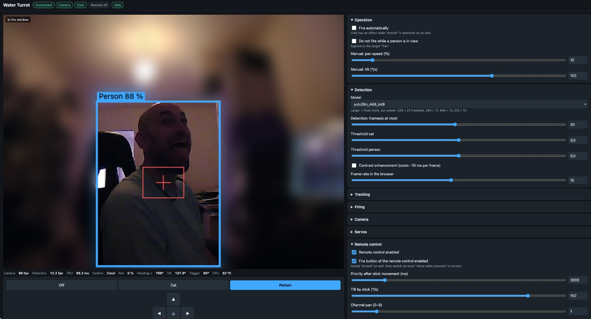

# Water Turret – camera-guided water gun for cats (or people)

A MakerWorld "Remote Controlled Water Turret" (CyberBrick, Assembly V1.5) converted into a turret
that guards a passage on its own. A Coral Dev Board watches a USB camera, detects cats or people
with a YOLO model on the Edge TPU, turns the turret towards the target and – only if you arm it –
pulls the trigger. The original remote control keeps working and always has priority.



*The batteries in the photo are only in there for testing. Normally the turret runs entirely on
mains power: the Coral on an ordinary USB phone charger, everything else (Core, servos, gun) on an
adjustable power supply. Plug in those two and it runs.*



*The web UI while the turret follows a person (not armed). The red cross is the aim point, the red
square the fire window.*

> **Status: V1, work in progress.** Tracking a person works smoothly on the bench. Not done yet:
> a live test with a real cat, mains power instead of batteries, weather protection, and the tank
> of my print leaks. Comments in the source code are still in German.

## How it works

```
 USB camera ──USB-A──▶ Coral Dev Board ──USB-C (serial)──▶ CyberBrick Core ──▶ 3 servos
 (IR, MJPEG)           detection, tracking,                 MicroPython,        pan / tilt / trigger
                       web UI on port 8080                  safety logic
                                                            ▲
                                    original remote control ┘ (radio, overrides the Coral)
```

- **Coral Dev Board** (`coral/`): grabs MJPEG frames with ffmpeg, runs YOLO on the Edge TPU
  (~12 detections/s at 448 px), picks the single most confident detection of the selected class,
  and sends drive commands to the Core 20 times a second. It also serves the web UI.
- **CyberBrick Core** (`turret_main.py`): a small MicroPython program that replaces the stock RC
  app. It drives the three servos, reads the remote control, and enforces the safety rules below.
  Nothing is flashed – the file is only copied onto the Core.
- **Web UI** (`web/`): live video with the detection and aim point, target selection
  (Off / Cat / Person), manual control, arming, and every tuning value. The settings form is built
  from the schema in `coral/settings.py`, so a new setting needs no UI code.

### Remote control override

The Core keeps listening to the original remote control. As soon as a stick moves, the remote
takes over and commands from the Coral are ignored until the sticks have been idle for 3 s
(`Priority after stick movement`). The fire button of the remote is disabled by default and, like
everything else, only works while the turret is armed.

### Safety

- After every start the turret is **safe**: the trigger servo is parked and nothing can fire it,
  neither the Coral nor the remote control. Arming is a deliberate click in the web UI.
- Automatic firing needs two switches: `Fire automatically` **and** `Armed`.
- With the target "Cat", the turret does not fire while a person is in view (`protect_person`).
- If the Core receives no command for 300 ms, it stops turning and releases the trigger.
- A burst is limited on the Core itself (`fire_max_ms`), whatever the Coral asks for.
- If the Core restarts or the connection drops, it comes back safe.

It is a water gun, but please point it only at targets that have it coming, and keep it away from
electronics and from people who did not agree to it.

## Hardware

| Part | Notes |
|---|---|
| MakerWorld "Remote Controlled Water Turret" (CyberBrick), Assembly V1.5 | printed and assembled as in the original instructions |
| CyberBrick Core (ESP32-C3) + Receiver Shield X11 + remote control | from the CyberBrick kit; sits in the rotating part |
| Coral Dev Board (4 GB), Mendel Linux | does detection and tracking; a Raspberry Pi with a Coral USB Accelerator should work with small changes, but is untested |
| USB camera with IR LEDs, 640×480 MJPEG | strapped to the barrel with cable ties, so it turns and tilts with the gun |
| USB-C cable Coral → Core | data (serial) only; do not rely on it for servo power |
| Adjustable mains power supply, set to the battery voltage of the kit (about 8 V), with a fuse | powers the X11 shield, servos and gun; replaces the batteries, which are only used for testing |
| Ordinary USB phone charger, 5 V / 3 A, USB-C | for the Coral |

### Wiring

| From | To | Purpose |
|---|---|---|
| Camera | Coral USB-A | video (`/dev/video1`) |
| Coral USB-C (data port, switched to host role) | Core USB-C | serial link `/dev/ttyACM0` |
| X11 **S1** (GPIO 3) | pan servo (360° continuous rotation) | turning |
| X11 **S2** (GPIO 2) | tilt servo | up / down |
| X11 **S3** (GPIO 1) | trigger servo | 90° safe · 20° armed, waiting · 0° firing |
| Adjustable power supply (or battery for testing) | X11 power input | Core, servos and gun |
| USB phone charger | Coral power input (USB-C) | Coral and camera |

The servo assignment is the one from the original kit, so nothing has to be rewired inside the
turret. The only additions are the camera and the USB cable to the Core.

Things I learned the hard way:

- **Power the Core through the X11 shield, not only through USB.** With the battery empty or
  switched off, the Core hangs on the Coral's USB port alone and resets every few seconds to
  minutes as soon as the camera streams and the Edge TPU is busy.
- **The pan servo is a continuous-rotation servo without position feedback.** It has a dead band
  and then immediately turns fast (~230 pixels/s in the camera image); it cannot go slower. The
  tracker therefore corrects with short pulses and waits for a frame taken *after* the movement
  before it decides again. Without that pause it oscillates.
- **The turret has mechanical end stops** (about half a turn in total on my build). Estimating the
  heading from "speed × time" drifted by tens of degrees within minutes and then blocked turning at
  the wrong place, so that limit is off by default. Instead the tracker notices when several pulses
  in one direction do not reduce the error and pauses in that direction for 3 s.
- **Secure the camera's USB plug.** A loose connector takes the camera off the bus; add strain
  relief.
- SSD models (ssdlite_mobiledet, ssd_mobilenet) hard-reset my Coral within a minute while the USB
  camera was streaming. YOLO models run stable. Cause unknown, possibly the power supply.

## Software setup

Layout on the Coral: `~/turret/app` (Python), `~/turret/web`, `~/turret/models`, `~/turret/tools`,
settings in `~/turret/settings.json`.

1. **Coral**: Mendel Linux with `pycoral`, OpenCV, `aiohttp`, `pyserial` and `ffmpeg`
   (Python 3.7 on my board). SSH access with a key.
2. **Model**: put a YOLO model compiled for the Edge TPU into `~/turret/models/`. The file name
   must contain `yolo`; the app expects the raw YOLOv8/YOLO26 output with the 80 COCO classes
   (person = 0, cat = 15). I use a YOLO26n int8 model at 448 px. The model files are not part of
   this repository.
3. **Deploy**: `deploy/deploy.ps1` copies app, web UI and tools to the Coral and restarts the
   service (adjust the host name at the top). `deploy/turret.service` is the systemd unit,
   `deploy/usb-host-role.service` switches the USB-C port to host role so the Core shows up as
   `/dev/ttyACM0`. `deploy/harden.sh` is optional (watchdogs, Wi-Fi reconnect, persistent journal).
4. **Core**: `deploy/deploy.ps1 -Core` copies `turret_main.py` to `/app/` on the Core with
   `mpremote`; `boot.py` goes to `/`. **Do not flash the Core with third-party tools** – according
   to the manufacturer that bricks it. Copying files is enough. To get the stock RC firmware back,
   create an empty file `/turret_off` on the Core; `boot.py` then starts the original app. If
   `turret_main` crashes, the original app starts as well.
5. Open `http://<coral>:8080`.

### First steps in the web UI

1. Leave the target on **Off** and try the arrow buttons (or the arrow keys / WASD). If an axis
   moves the wrong way, change `Pan direction` / `Tilt direction`.
2. **Aim point**: the camera sits above the barrel, so the jet does not hit the centre of the
   image. Fire once at a wall and double-click the spot in the video where the water hit.
3. Select **Person** and walk around. The turret should follow you; it will not fire as long as
   it is not armed.
4. Only then arm it and, if you want, switch on `Fire automatically`.

`deploy/settings.v1.json` holds the values tuned for my build. Aim point, tilt home position and
the servo dead band depend on your print and your servos.

## Protocol

Coral → Core, one line per command:

| Line | Meaning |
|---|---|
| `C,<mode>,<pan%>,<dtilt°>,<fire>` | drive command, 20 Hz; pan −100…100, tilt relative |
| `K,<name>,<value>` | set a parameter |
| `X,<angle>` | absolute tilt |
| `T,<angle>` | test the trigger servo (only while safe, never as far as firing) |
| `Z[,<deg>]` | set the heading estimate |
| `?` | print all parameters |

Core → Coral every 200 ms: `S,<source>,<pan%>,<pan_est>,<tilt>,<trigger>,<armed>,<rc>`.

The web UI talks to the Coral over a WebSocket (`/ws`): `{t:'set',k,v}`, `{t:'manual',pan,tilt}`,
`{t:'pulse',pan,s}` and `{t:'cmd',c:'arm'|'stop'|'fire'|'tilt_home'|'pan_zero'|'trig'|'restart'}`.

## Tools

In `tools/`, run on the Coral:

- `probe.py [s] [image|-] [json commands…]` – watch status and detections, send commands
- `servotest.sh tilt|pan|trig` – move one axis briefly (safe, no shot)
- `pancal.py`, `pulsecal.py` – measure the image shift per drive command / per short pulse
- `turnstep.py` – turn in short steps and measure the range between the end stops
- `bench.py`, `evalset.py` – compare models (stop the service first, the TPU is busy otherwise)

## Measured on my build

- Detection on the Edge TPU, daylight test set: YOLO26n at 320 px – 36 ms, cats 65 %;
  384 px – 50 ms, 70 %; **448 px – 65 ms, 80 %**; 512 px – 85 ms, 84 %. People 84–97 %.
- Not verified yet: how well cats are found at night with this near-infrared camera.

## License

The code in this repository is released under the [MIT License](LICENSE). The turret model itself
and the CyberBrick firmware belong to their authors and are not part of this repository.

## Credits

- Turret model and electronics: the "Remote Controlled Water Turret" project on MakerWorld and the
  CyberBrick platform by Bambu Lab. [CyberBrick API](https://makerworld.com/en/cyberbrick/api-doc/),
  [official RC code](https://github.com/CyberBrick-Official/CyberBrick_Controller_Core).
- [Coral Dev Board](https://gweb-coral-full.uc.r.appspot.com/docs/dev-board/datasheet/) by Google.
